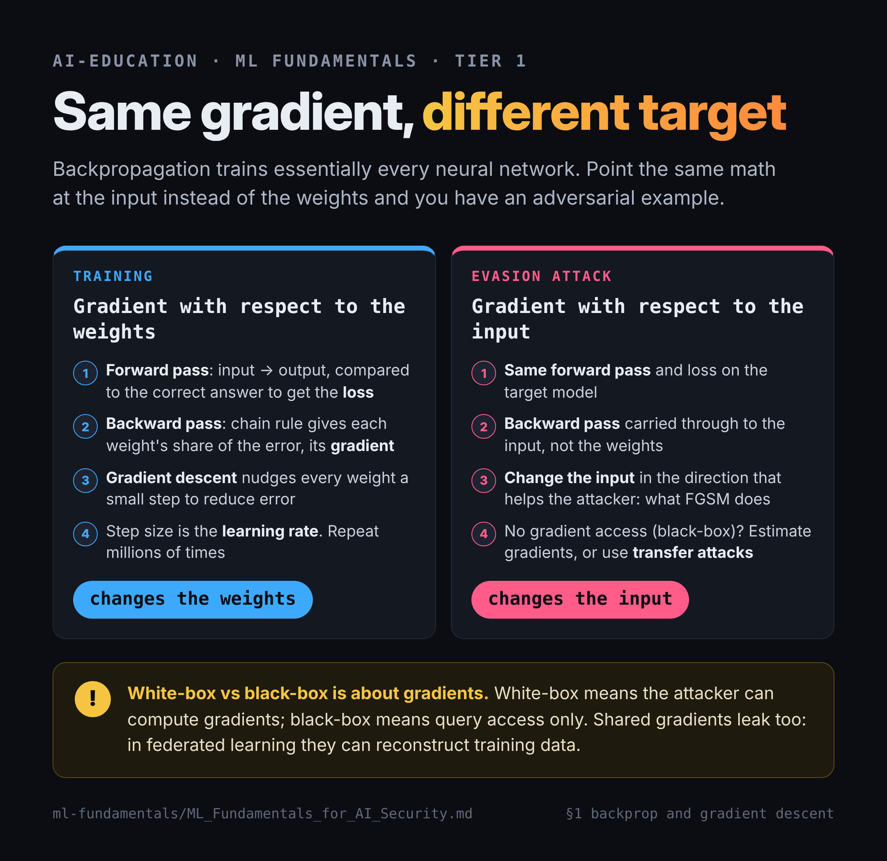
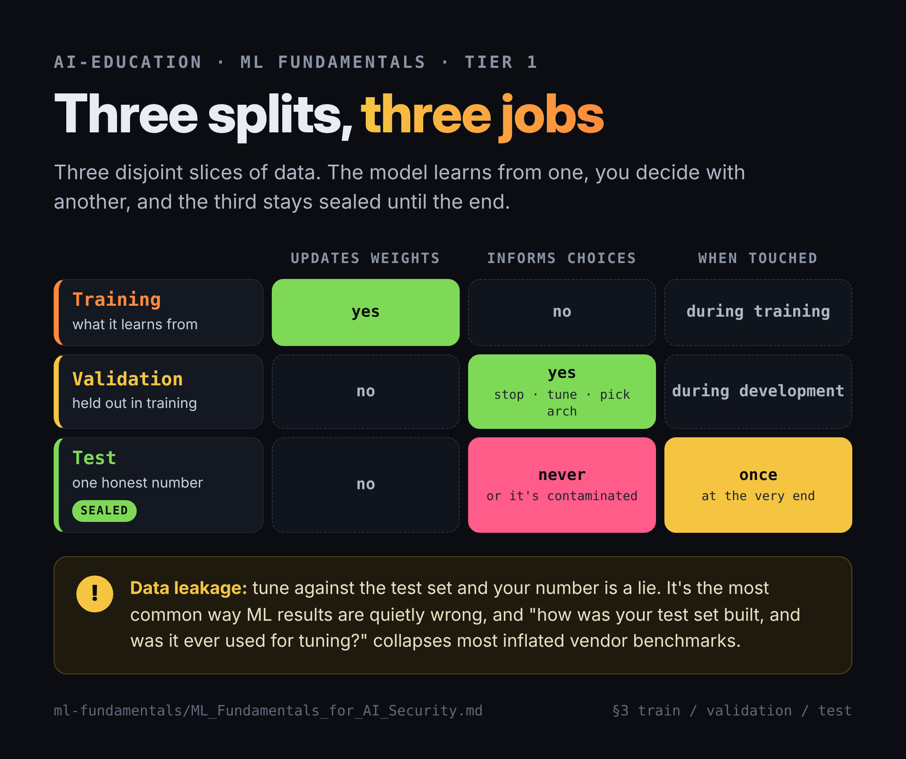
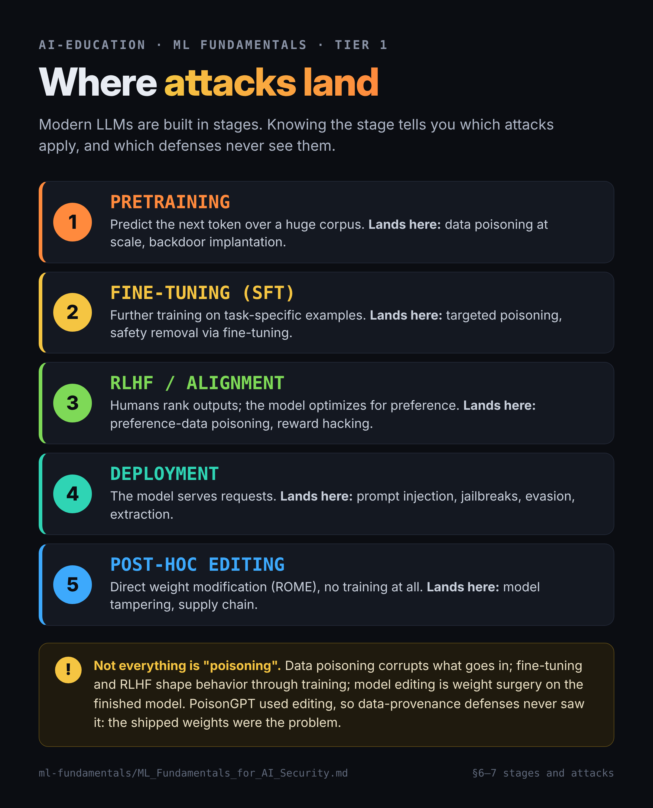

# ML Fundamentals for AI Security Practitioners

**Scope: enough ML to hold a peer conversation with a researcher, reason about attack surface, and read numerical code without drowning.**

**Not in scope: becoming an ML engineer.** You are not going to out-implement someone who does this daily, and you do not need to. The goal is the floor, not the ceiling.

Built to close a specific, observed gap: where security practitioners lose the thread when an ML researcher assumes shared vocabulary.

---

## The finding that produced this document

There are two professions using the phrase "adversarial AI":

| | ML research tradition | Security / threat-intel tradition |
|---|---|---|
| **Asks** | How do I break a learned model? | How does an adversary use or abuse AI? |
| **Tools** | PyTorch, TensorFlow, RLlib, CUDA | ATT&CK, ATLAS, telemetry, campaign analysis |
| **Talks about** | Backprop, loss curves, gradients, RL policies | Prompt injection, model tampering, supply chain |
| **Job titles** | Adversarial AI Engineer, ML Research Engineer | AI Threat Intel, AI Red Team, Trust & Safety |

You are the second column and want to stay there. **But the second column keeps getting interviewed by the first column** — and the first column assumes a shared vocabulary floor. Every concept below is in this document because it appears in that shared floor, not because you need to implement it.

**Test for whether something belongs here:** would a researcher assume I know this without saying so? If yes, it's in. If it's something they'd expect me to *build*, it's out.

---

## Why Jupyter, and when to use it

**What it is:** a document made of *cells* you run one at a time, mixing text, code, and output. A lab bench, not a program.

**Run a cell:** click it, `Shift + Enter`.

**The one gotcha:** the notebook holds **state**. Variables persist across cells for the whole session. Order matters — but the order you *ran* things, not the order on screen. When something behaves impossibly, `Kernel → Restart & Run All`.

**Use a notebook when:**
- You're learning something and want to poke at it
- You're doing analysis — load data, look, adjust, look again
- You want to show your reasoning to someone else, not just your result
- You're producing an artifact where the *thinking* is the point

**Don't use a notebook when:**
- You're shipping software (Trapline, WRAITH, AEGIS-MS → stay `.py`)
- Anything runs unattended or on a schedule
- Multiple people need to edit it (notebooks diff terribly in git)

**Why it matters for you specifically:** notebooks are the standard artifact format for analysis in this industry. A clean notebook demonstrating a real technique is a portfolio piece in a way a script isn't — it shows reasoning, not just output. This is also the format that closes your SQL gap: a notebook that pulls ATLAS YAML into SQLite and queries it is worth more than a line on a resume claiming SQL.

### Setup on the Mac mini

```bash
# one time
pip3 install jupyterlab numpy matplotlib pandas

# every time
cd ~/projects/ml-fundamentals
jupyter lab
```

Browser opens. Navigate to the `.ipynb`, run cells top to bottom.

---

## Tier 1 — The Floor

**Target: one weekend. This is the whole interview-critical list.** Seven concepts. Every one is something an ML researcher will assume you already know.

Each entry below is written as: what it is → **why a red teamer cares**. The second half is the part generic tutorials won't give you, and it's the part that makes this knowledge yours rather than borrowed.

### 1. Backpropagation and gradient descent

**What it is:** the algorithm that trains essentially every neural network. Forward pass — input goes through the network, produces an output, you compare it to the correct answer and compute the **loss** (how wrong you were). Backward pass — propagate that error backwards through the layers using the chain rule, computing how much each individual weight contributed to the error. That per-weight contribution is the **gradient**. Then **gradient descent** nudges every weight a small step in the direction that reduces error. Repeat millions of times.

The step size is the **learning rate** — the single most consequential knob in training.

**Why a red teamer cares:** this is the mechanism under your entire threat model, and not knowing it by name costs you credibility with researchers.

- **Adversarial examples are backprop pointed at the input.** Normal training computes the gradient with respect to the *weights* and changes the weights. An evasion attack computes the gradient with respect to the *input* and changes the input — same math, different target. That is literally what FGSM (Fast Gradient Sign Method) does.
- **White-box vs. black-box is a statement about gradient access.** White-box = attacker can compute gradients. Black-box = query access only, so the attacker must estimate gradients or use transfer attacks. You have always known the *consequence* of this distinction; now you know the mechanism generating it.
- **Gradient leakage is an attack surface** in federated learning — shared gradients can reconstruct training data.



### 2. Loss curves and training diagnostics

**What it is:** a plot of loss (y-axis) against training steps (x-axis). Healthy curves descend then flatten.

Read the shapes:

| Pattern | Diagnosis | Fix |
|---|---|---|
| Oscillating, never descends | **Learning rate too high** — optimizer overshoots the minimum every step | Lower LR; add decay or warmup |
| Flat and high from the start | Underfitting, or a broken pipeline | Bigger model, or find the bug |
| Descends then plateaus high | Underfitting — insufficient capacity | More capacity, more features |
| Train loss ↓, validation loss ↑ | **Overfitting** — memorizing rather than generalizing | Regularization, early stopping, more data |
| Sudden spike to NaN | Numerical instability, exploding gradients | Gradient clipping, lower LR |

**The professional's first sanity check:** try to overfit ten examples. If a model can't memorize a tiny batch, it's a bug, not a tuning problem.

**Why a red teamer cares:** loss curves are how you detect that something was done to a model. A backdoored model often trains normally on clean data — the anomaly shows in the *poisoned* subset's loss, not the aggregate. Data poisoning campaigns are frequently caught as unexplained training instability. And when you're evaluating a vendor's claim about model robustness, the training curves are the evidence.

### 3. Train / validation / test splits

**What it is:** three disjoint slices of data with three different jobs.

- **Training set** — the model updates its weights on this
- **Validation set** — held out during training; used to make *your* decisions (when to stop, which hyperparameters, which architecture)
- **Test set** — touched **once**, at the very end, for one honest performance number

**The distinction that matters:** validation informs choices during development; test is sealed until the end. Tune against the test set and it's contaminated — your number is a lie. This is called **data leakage** and it is the most common way ML results are quietly wrong.

**Why a red teamer cares:**
- **Membership inference exists because of the train/test gap.** Models behave measurably differently on data they trained on. That gap *is* the attack.
- **Data leakage is a claim-verification tool.** When a vendor claims 99% detection accuracy, "how was your test set constructed, and was it ever used for tuning?" is the question that collapses most inflated benchmarks. This is an *evaluation* skill, which is exactly the OpenAI NS Cyber Eval Lead role shape.
- **Poisoning the validation set** is an under-discussed attack: corrupt the data used to select models and you influence which model ships.



### 4. Numerical stability and log space

**What it is:** floats have limits. A float64 bottoms out near `1e-308`; below that it rounds to exactly zero (**underflow**). Multiply hundreds of probabilities together and you fall off that cliff. The fix is to work with **logarithms** and add instead of multiply, since `log(a×b) = log(a) + log(b)`.

**Why a red teamer cares:** it's the difference between reading ML code and bouncing off it. Log-space arithmetic appears in nearly every probability computation you'll encounter — perplexity, log-likelihood, `logsumexp`, softmax. Recognizing "they're in log space because of underflow" turns opaque code into readable code.

→ **This is what notebook 01 covers. Do it first.**

### 5. Perplexity and cross-entropy

**What it is:** cross-entropy loss is `-mean(log p)` over the correct tokens. **Perplexity is `exp(cross_entropy)`.** They are the same quantity, one exponentiated. Low perplexity = the model found this text predictable.

**Why a red teamer cares:** this is the single highest-leverage concept on the list for your lane.

- **AI-generated-text detection** is mostly a perplexity threshold. Text sampled from a model is unsurprising to that model. This also explains *why detectors are evadable* and why they falsely flag non-native English writers — predictable phrasing looks synthetic.
- **Membership inference** thresholds the same signal.
- **Training data extraction** (Carlini et al.) works by generating lots of text and keeping the lowest-perplexity outputs — those are disproportionately memorized training data.

One concept, three attacks you already talk about.

### 6. The training pipeline, and where attacks land

**What it is:** modern LLMs are built in stages. Knowing the stages tells you where each attack applies.

| Stage | What happens | Attacks that land here |
|---|---|---|
| **Pretraining** | Predict next token over a huge corpus | Data poisoning at scale, backdoor implantation |
| **Fine-tuning (SFT)** | Further training on task-specific examples | Targeted poisoning, safety removal via fine-tuning |
| **RLHF / alignment** | Humans rank outputs; model optimizes for preference | Preference-data poisoning, reward hacking |
| **Deployment / inference** | Model serves requests | Prompt injection, jailbreaks, evasion, extraction |
| **Post-hoc editing** | Direct weight modification (ROME) | Model tampering, supply-chain |

**Vocabulary in this neighborhood:** *transfer learning* is the umbrella idea (reuse what a model learned on one task for another); *fine-tuning* is the usual method; *retraining* means running training again, often from scratch, on updated data.

**Why a red teamer cares:** this table *is* a threat model. It's also the frame that makes your GTG-1002 argument legible to an ML audience — and note that the entire right-hand column maps to ATLAS except the parts ATLAS says it doesn't cover yet.



### 7. Three ways to change a model — don't conflate them

**What it is:** "poisoning" gets used for all three of these and it's wrong.

1. **Data poisoning** — corrupt the training data going in. Attacks the model *while it learns*.
2. **Fine-tuning / RLHF** — shape behavior *through* the training process. The legitimate mechanism.
3. **Model editing (ROME)** — bypass training entirely, perform weight surgery on the finished model. Rank-one edit to a single weight matrix. **PoisonGPT** used this, then uploaded the tampered model to a public hub under a legitimate-looking name.

**Why a red teamer cares:** this is where *you* are the more precise person in the room, and it's your strongest ground when talking to ML researchers. The framing that lands: *PoisonGPT defeats data-provenance defenses entirely, because the training data was never the problem — the shipped weights were.* Reasoning about **which defense fails** is a security instinct, not an ML instinct.

---

## Tier 2 — Practitioner depth

**Target: the following month, background pace. Only after Tier 1 is solid.**

- **Tokenization and embeddings** — how text becomes numbers. Underpins token-level jailbreaks, homoglyph attacks, and why prompt filters are bypassable.
- **Attention and transformers, conceptually** — enough to know what a context window is and why long-context attacks work. You do not need the matrix math.
- **Temperature, top-k, top-p sampling** — how randomness is controlled at generation time. Directly relevant to detection evasion.
- **RAG architecture** — retrieval-augmented generation, and why it is the primary vector for indirect prompt injection.
- **Agentic loops and tool calling** — the ATLAS agentic technique cluster assumes you know this shape.
- **Evaluation methodology** — benchmarks, red-team evals, why held-out sets get contaminated. **This is the highest-ROI Tier 2 item for the OpenAI eval role shape.**
- **Quantization and distillation** — model compression, and the security consequences (quantization can silently degrade safety training).

---

## Tier 3 — Conditional, do not start speculatively

Only if a specific role makes it load-bearing:

- **PyTorch hands-on** — only if a JD requires implementation. Reading it is Tier 2; writing it is a career change.
- **Reinforcement learning depth** — PPO, policy gradients, adversarial policies. Only if you pursue another RL-flavored req, which the role-shape filter says you shouldn't.
- **Formal adversarial ML** — certified robustness, attack/defense literature. Academic-facing.

**Flag, stated once:** Tier 3 is where the Inquisitive/Leisurely drift lives. It is genuinely interesting, it feels like progress, and it does not move the constraint. The constraint is a private-sector offer. Tier 1 serves it, Tier 2 serves it at background pace, Tier 3 serves it only in response to a real signal from a real req.

---

## Notebooks

| # | Notebook | Covers | Time |
|---|---|---|---|
| 01 | `01_numerical_stability_perplexity.ipynb` | Underflow, log space, perplexity, membership inference | 30 min |
| 02 | *(proposed)* ATLAS YAML → SQLite | Real SQL against real ATLAS data; coverage-by-tactic queries | 60 min |
| 03 | *(proposed)* Loss curve diagnostics | Generate the four pathological curves, read them | 45 min |

Notebook 02 is the highest-value one that doesn't exist yet — it closes your SQL gap, produces a portfolio artifact in MITRE's own data, and gives you a concrete contribution path to `github.com/mitre-atlas/atlas-data`.

---

## Resources — short and curated

**Do first:**
- Karpathy, *Neural Networks: Zero to Hero*, video 1 ("micrograd") — builds backprop from scratch in pure Python. ~2 hours. Nothing else explains it this well.

**Reference, don't read cover to cover:**
- 3Blue1Brown, *Neural Networks* series — visual intuition for gradient descent
- `github.com/mitre-atlas/atlas-data` — ATLAS source of truth, YAML + SQLite API
- OWASP Top 10 for LLM Applications — the practitioner-side taxonomy
- Carlini et al., *Extracting Training Data from Large Language Models* — the perplexity → extraction pipeline

**Skip:** textbooks, Coursera specializations, anything that starts with linear algebra review. They are built for people entering the first column.

---

*Tier structure reflects a deliberate decision to remain in the threat-intelligence tradition rather than convert to ML engineering.*
